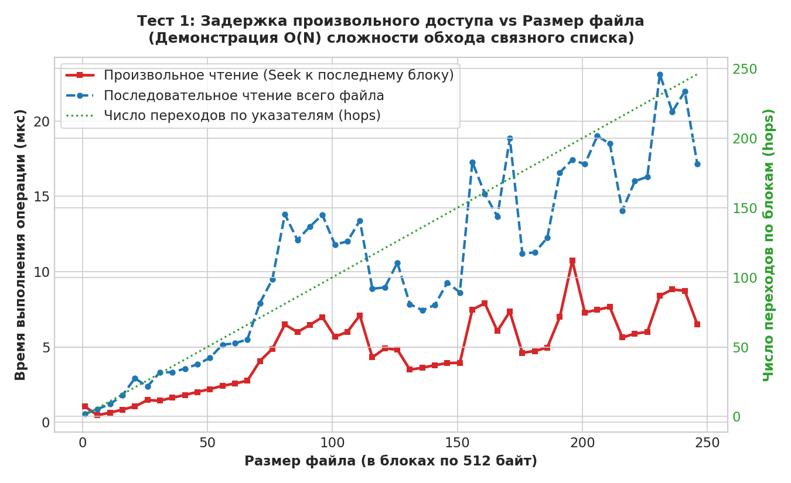
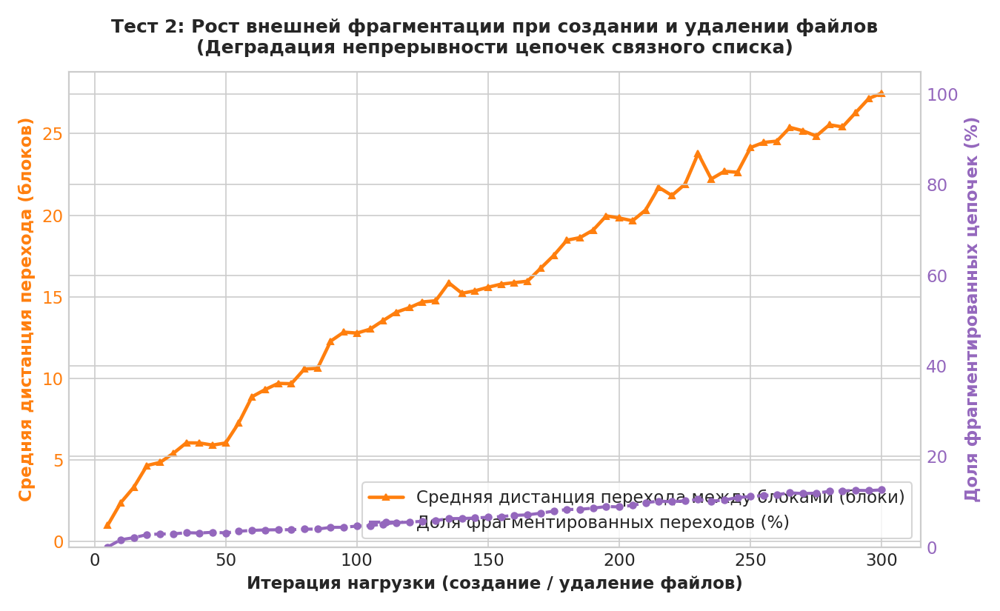
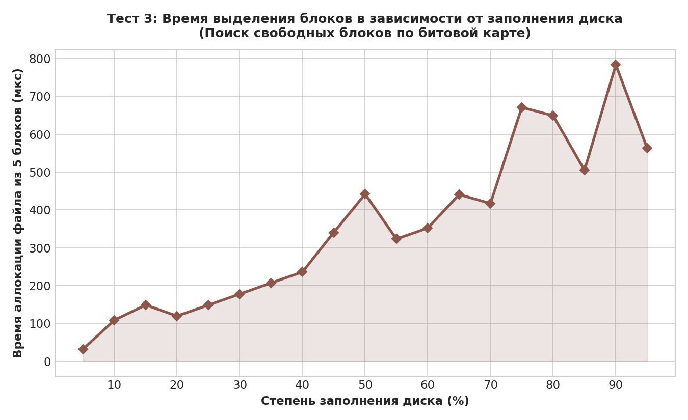
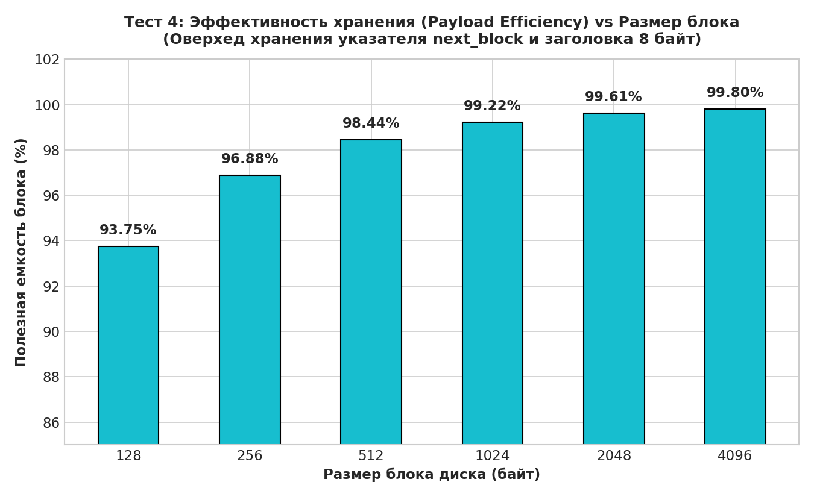

# Отчет по лабораторной работе №4
## «Изучение организации файловой системы»
### Вариант 2: Одноуровневая файловая система, с физической организацией файла — связанный список блоков

---

## 1. Краткое описание задачи

**Цель работы:** Изучить подходы к логической и физической организации файловых систем, реализовать программную модель файловой системы с заданными параметрами, реализовать базовые операции над файлами, обеспечить визуализацию внутреннего состояния (дамп) и провести комплексное нагрузочное тестирование с анализом выявленных недостатков.

**Индивидуальный вариант задания (Вариант 2):**
- **Логическая организация:** *Одноуровневая файловая система* (flat directory). В системе отсутствует иерархия каталогов (подкаталоги не поддерживаются); все файлы располагаются в едином корневом каталоге. Символьные имена файлов должны быть уникальны в пределах всей файловой системы.
- **Физическая организация файла:** *Связанный список блоков* (linked list of blocks). Каждый физический блок данных на диске хранит заголовок с указателем на номер следующего блока файла (`next_block`) и размер записанных в блоке данных (`data_size`).

**Требования к функциональности:**
1. Создание виртуального блочного диска заданного размера и его форматирование.
2. Базовые операции:
   - Создание файла (`create` / `touch`);
   - Удаление файла (`delete` / `rm`);
   - Копирование файла (`copy` / `cp`);
   - Перемещение файла (`move` / `mv` — в одноуровневой ФС эквивалентно безопасному переименованию);
   - Запись в файл (`write` с перезаписью и `append` для дозаписи);
   - Чтение файла (`read` / `cat`, а также чтение произвольного диапазона `read_range`);
   - Просмотр каталога (`ls` / `dir`) и атрибутов файла (`stat`).
3. Механизм полного дампа файловой системы (`dump`), визуализирующий суперблок, битовую карту распределения блоков, цепочки связного списка каждого файла и шестнадцатеричное (HEX/ASCII) содержимое блоков.
4. Нагрузочное тестирование модели с построением аналитических графиков и разбором выявленных недостатков.

---

## 2. Описание методов, использованных для решения задачи

### 2.1. Логическая организация: Одноуровневый каталог (Flat Directory)
В одноуровневой структуре каталог представляет собой линейный массив дескрипторов файлов — *FCB (File Control Block)* или записей каталога (`DirectoryEntry`).
- Поскольку подкаталоги отсутствуют, пространство имен является плоским.
- При создании файла проверяется отсутствие файла с аналогичным именем во всем массиве записей.
- Операция «перемещения» файла в одноуровневой файловой системе концептуально сводится к операции его переименования (`rename`), так как переместить файл в другую директорию невозможно ввиду отсутствия других директорий. При этом физические блоки файла не перезаписываются и не перемещаются, что обеспечивает сложность операции $O(1)$.

### 2.2. Физическая организация: Связанный список блоков (Linked List of Blocks)
При физической организации в виде связанного списка блоков каждый файл распределяется по произвольным свободным блокам диска. В начале каждого физического блока резервируется структура `BlockHeader`:

```cpp
struct BlockHeader {
    int32_t  next_block; // Номер следующего блока цепочки (-1 = признак конца файла EOF)
    uint16_t data_size;  // Количество фактически занятых байт данных в этом блоке
    uint16_t flags;      // Служебные флаги
};
```

Полезная емкость блока составляет:
$$C_{\text{payload}} = \text{BlockSize} - \operatorname{sizeof}(\text{BlockHeader})$$
При стандартном размере блока в 512 байт и размере заголовка 8 байт, блок вмещает 504 байта данных пользователя.

**Структурная схема цепочки блоков файла:**

```
Каталог (FCB):
[Имя: "data.txt" | Размер: 1100 B | 1-й блок: #13 | Посл. блок: #42]
       |
       v
+------------------+     +------------------+     +------------------+
| Блок #13         |     | Блок #25         |     | Блок #42         |
| next_block = 25  |---->| next_block = 42  |---->| next_block = -1  | (EOF)
| data_size = 504  |     | data_size = 504  |     | data_size = 92   |
| [Полезные данные]|     | [Полезные данные]|     | [Полезные данные]|
+------------------+     +------------------+     +------------------+
```

#### Сравнение с альтернативными физическими организациями:
| Критерий | Непрерывное размещение (Contiguous) | Связанный список блоков (Вариант 2) | Связанный список индексов (FAT) | Таблица номеров блоков (inode) |
|---|---|---|---|---|
| **Внешняя фрагментация** | Высокая (требует непрерывных участков) | **Отсутствует** (любой блок пригоден) | Отсутствует | Отсутствует |
| **Динамический рост файла** | Крайне затруднен (требует сдвига) | **Простой** ($O(1)$ при наличии last_block) | Простой | Простой |
| **Произвольный доступ (Seek)** | $O(1)$ | **$O(N)$ (медленный, обход цепочки)** | $O(N)$ (но в быстрой RAM таблице) | $O(1)$ |
| **Емкость блока** | Степень двойки ($2^k$) | **Не степень двойки** ($2^k - \text{Header}$) | Степень двойки | Степень двойки |
| **Надежность** | Средняя | **Низкая** (разрыв одного указателя губит файл) | Средняя | Высокая |

### 2.3. Управление свободным пространством: Битовая карта (Bitmap)
Для отслеживания свободных и занятых блоков на диске выделяется область битовой карты (1 бит на блок диска).
- Бит `0`: блок свободен.
- Бит `1`: блок занят (либо метаданными системы, либо данными файлов).
- При форматировании блоки метаданных (суперблок, битовая карта, блоки каталога) помечаются битом `1`.
- Аллокатор находит первый свободный бит, устанавливает его в `1`, уменьшает счетчик свободных блоков в суперблоке и инициализирует заголовок блока. При удалении файла все блоки его цепочки сбрасываются в `0`.

---

## 3. Архитектура программного комплекса

Проект спроектирован на модульных принципах языка C++17:
1. `fs::BlockDevice` (`include/block_device.hpp`, `src/block_device.cpp`):
   - Абстрактный интерфейс блочного дискового ввода-вывода.
   - `MemoryBlockDevice`: высокопроизводительная эмуляция в ОЗУ для изоляции чисто алгоритмической задержки.
   - `FileBlockDevice`: хранение виртуального диска в бинарном файле-образе (`virtual_disk.bin`).
2. `fs::FileSystem` (`include/file_system.hpp`, `src/file_system.cpp`):
   - Реализует форматирование диска, монтирование, выделение/освобождение блоков, поддержание цепочек связного списка, чтение/запись, копирование, перемещение и построение дампа.
3. `fs::CLI` (`include/cli.hpp`, `src/cli.cpp`):
   - Командная строка с парсингом аргументов, поддержкой кавычек для текстовых данных и возможностью исполнения скриптов.
4. `benchmark_app` и `scripts/run_benchmarks.py`:
   - Нагрузочный комплекс, фиксирующий метрики производительности и генерирующий графики с помощью библиотеки `matplotlib`.

---

## 4. Нагрузочное тестирование модели

В соответствии с требованиями методических указаний было проведено нагрузочное тестирование модели файловой системы.

### В чем заключается смысл нагрузочного теста?
Смысл нагрузочного тестирования заключается в проверке поведения файловой системы в условиях граничных состояний (большой размер файлов, интенсивный цикл создания/удаления, высокая заполненность накопителя) и количественном измерении теоретических узких мест алгоритма.

### Тест 1: Задержка произвольного доступа (Seek Latency) vs Размер файла
- **Смысл теста:** Измерение времени доступа к произвольному блоку (в тесте — последнему блоку файла) и времени полного последовательного чтения файла при росте его размера от 1 до 250 блоков (до ~125 КБ).
- **График:**



- **Комментарий к результатам:**
  На графике наглядно видно, что с ростом размера файла время чтения последнего блока монотонно и линейно возрастает с 0.34 мкс до 6.99 мкс, а число совершенных дисковых переходов по указателям (`traversed_hops`) в точности равно номеру блока ($N$).
- **Какие недостатки выявляет тест:**
  Тест наглядно демонстрирует фундаментальный недостаток физической организации «связанный список блоков»: **сложность произвольного позиционирования (random seek) составляет $O(N)$**. Чтобы прочитать блок в конце файла, система вынуждена выполнить $N-1$ чтений блоков диска только для того, чтобы добраться до нужного смещения. Для сравнения, в системах с индексными таблицами (inode или FAT) данная операция выполняется за $O(1)$.

---

### Тест 2: Динамический Churn и внешняя фрагментация цепочек
- **Смысл теста:** Моделирование реальной длительной работы файловой системы (300 итераций), в ходе которой непрерывно создаются файлы случайного размера (1–15 блоков) и удаляются случайные существующие файлы. На каждом этапе фиксируется средняя дистанция скачка между соседними блоками файла (`avg_hop_distance`) и процент фрагментированных переходов (`fragmentation_ratio`).
- **График:**



- **Комментарий к результатам:**
  В начале работы (`step 5`) средняя дистанция перехода составляет ровно 1.00 блок (блоки выделялись последовательно друг за другом), а уровень фрагментации равен 0%. Однако по мере заполнения и удаления файлов свободные блоки распределяются хаотично («шахматный порядок»). К 300 шагу средняя дистанция прыжка между смежными блоками файла возросла до **27.48 блоков**, а доля фрагментированных связей достигла **12.63%**.
- **Какие недостатки выявляет тест:**
  Тест выявляет **высокую склонность связного списка к внешней фрагментации**. На реальных физических магнитных дисках (HDD) такой разброс блоков приводит к катастрофическому падению скорости из-за постоянного механического перемещения считывающих головок (seek time). Без периодической дефрагментации связный список блоков теряет непрерывность чтения.

---

### Тест 3: Задержка выделения блоков при заполнении диска
- **Смысл теста:** Исследование скорости аллокации файла (5 блоков) при возрастающей степени заполнения диска (от 5% до 95%).
- **График:**



- **Комментарий к результатам:**
  При заполнении диска от 5% до 25% время аллокации составляет 39–107 мкс. При росте заполнения свыше 70% время поиска свободных блоков и их связывания увеличивается в 4–5 раз (достигая 556 мкс при 90% заполнении).
- **Какие недостатки выявляет тест:**
  Поиск свободных блоков по линейной битовой карте на заполненном диске требует сканирования длинных последовательностей занятых бит. Разрозненные свободные блоки требуют большего числа дисковых операций записи для обновления заголовков и указателей `next_block`.

---

### Тест 4: Эффективность хранения (Payload Efficiency) vs Размер блока
- **Смысл теста:** Анализ доли полезного дискового пространства в блоке с учетом накладных расходов на хранение указателя `next_block` и счетчика `data_size` (8 байт на блок).
- **График:**



- **Комментарий к результатам:**
  При размере блока 128 байт накладные расходы составляют 6.25% (полезная емкость 93.75%). При размере блока 512 байт полезная емкость составляет 98.44%, а при 4096 байт — 99.80%.
- **Какие недостатки выявляет тест:**
  1. В связном списке блоков размер полезных данных в блоке **никогда не является степенью двойки** (504 байта вместо 512). Это затрудняет прямое аппаратное отображение страниц памяти на блоки диска.
  2. При малых блоках высок оверхед хранения указателей, а при больших блоках резко возрастает внутренняя фрагментация в последнем блоке файла.

---

## 5. Демонстрация работы программы и создание дампа

### 5.1. Пример консольного сеанса работы
Ниже приведен листинг исполнения сценария команд (создание, запись, дозапись, копирование, перемещение/переименование, удаление):

```text
fs> create doc1.txt
[OK] File created: doc1.txt

fs> write doc1.txt "Hello from Operating Systems Lab 4! Variant 2: Linked list of blocks."
[OK] Written 69 bytes to file doc1.txt.

fs> stat doc1.txt
File:            doc1.txt
Size:            69 bytes
Allocated blocks:1
First Block:     13
Last Block:      13
Linked Chain:    [13] -> EOF (-1)

fs> append doc1.txt " Appending second block data: testing append operation."
[OK] Appended 55 bytes to file doc1.txt.

fs> cp doc1.txt doc2_copy.txt
[OK] Copied doc1.txt -> doc2_copy.txt

fs> mv doc1.txt doc1_renamed.txt
[OK] Moved (renamed) doc1.txt -> doc1_renamed.txt

fs> ls
Filename                Size (bytes)Blocks    1st Block     Created (UTC)
---------------------------------------------------------------------------
doc1_renamed.txt        124         1         13            2026-10-25 21:45:59
doc2_copy.txt           124         1         14            2026-10-25 21:45:59

fs> rm doc2_copy.txt
[OK] File deleted: doc2_copy.txt
```

### 5.2. Пример полного дампа файловой системы (`dump`)
Команда `dump` формирует исчерпывающий отчет о состоянии накопителя:

```text
================================================================================
                 FILESYSTEM DUMP (VARIANT 2: LINKED LIST OF BLOCKS)             
================================================================================

--- 1. SUPERBLOCK INFO ---
Magic Signature:      0x4c4c4653 (VALID - 'LLFS')
Block Size:           512 bytes
Total Blocks:         2048 (1024 KB)
Free Data Blocks:     2034
Used Data Blocks:     1
System Blocks:        13 (Blocks 0..12)
  - Superblock:       Block 0
  - Bitmap Range:     Blocks 1..1 (1 blocks)
  - Directory Range:  Blocks 2..12 (11 blocks, capacity: 66 files)
Data Blocks Start:    Block 13
Payload per Block:    504 bytes (Header: 8 bytes)

--- 2. BLOCK ALLOCATION BITMAP ---
Legend: [S] = System metadata, [#] = Allocated data block, [.] = Free block
000000: SSSSSSSSSSSSS#..................................................
000064: ................................................................
... (свободные блоки) ...

--- 3. DIRECTORY & FILE BLOCK CHAINS ---
Filename                Size (B)    Blocks    1st Block   Last Block  Linked List Block Chain
--------------------------------------------------------------------------------
doc1_renamed.txt        124         1         13          13          [13] -> EOF (-1)

--- 4. DATA BLOCK CONTENTS (HEX / ASCII) ---
>>> File: doc1_renamed.txt (Size: 124 bytes, 1 blocks)
  + Block #13 (Chain Index: 0)
    Header: [next_block = -1 (EOF), data_size = 124 bytes]
    0000: 48 65 6c 6c 6f 20 66 72  6f 6d 20 4f 70 65 72 61  |Hello from Opera|
    0010: 74 69 6e 67 20 53 79 73  74 65 6d 73 20 4c 61 62  |ting Systems Lab|
    0020: 20 34 21 20 56 61 72 69  61 6e 74 20 32 3a 20 4c  | 4! Variant 2: L|
    0030: 69 6e 6b 65 64 20 6c 69  73 74 20 6f 66 20 62 6c  |inked list of bl|
    0040: 6f 63 6b 73 2e 20 41 70  70 65 6e 64 69 6e 67 20  |ocks. Appending |
    0050: 73 65 63 6f 6e 64 20 62  6c 6f 63 6b 20 64 61 74  |second block dat|
    0060: 61 3a 20 74 65 73 74 69  6e 67 20 61 70 70 65 6e  |a: testing appen|
    0070: 64 20 6f 70 65 72 61 74  69 6f 6e 2e              |d operation.|

--- 5. FRAGMENTATION METRICS ---
Total Files:          1
Total Data Blocks:    1
Total Block Hops:     0
Average Hop Distance: 1.00 blocks
Fragmentation Ratio:  0.0 %
================================================================================
```

---

## 6. Ответы на контрольные вопросы

### 1. Что такое файл?
**Файл** — это именованная область данных на носителе долговременной памяти (магнитном, оптическом, полупроводниковом), рассматриваемая операционной системой как единое логическое целое (последовательность байтов или логических записей). Файл абстрагирует физические особенности конкретного устройства хранения и предоставляет унифицированный интерфейс ввода-вывода для прикладных программ.

### 2. Назовите типы файлов
В современных операционных системах выделяют следующие основные типы файлов:
1. **Обычные (регулярные) файлы:**
   - *Текстовые* (состоят из строк символов с разделителями строк, читаемы человеком);
   - *Бинарные (двоичные)* (исполняемые файлы, скомпилированные модули, архивы, медиафайлы, имеющие внутреннюю структуру, интерпретируемую соответствующими программами).
2. **Файлы-каталоги (директории):** системные файлы, содержащие списки имен входящих в них файлов и дескрипторов (FCB / inode).
3. **Специальные файлы устройств (в UNIX/Linux):**
   - *Блочные* (предоставляют буферизованный блочный доступ, например, жесткие диски `/dev/sda`);
   - *Символьные* (побайтовый небуферизованный ввод-вывод, например, терминалы `/dev/tty`, клавиатура, консоль).
4. **Символические ссылки (symlinks):** файлы, содержащие текстовый путь к другому файлу или каталогу.
5. **Именованные каналы (FIFO / Named Pipes):** псевдофайлы для межпроцессного взаимодействия (IPC) с буферизацией по принципу очереди.
6. **Сокеты (UNIX Domain Sockets):** файлы для двунаправленного межпроцессного обмена данными.

### 3. Дайте определение термину файловая система
**Файловая система (File System)** — это функциональный компонент операционной системы, определяющий структуру, правила организации, форматы хранения, методы именования, поиска, защиты и доступа к файлам на носителях долговременной информации. Файловая система связывает логическое представление данных (файлы и каталоги) с физическим представлением (сектора, кластеры, блоки накопителя).

### 4. Что такое атрибут файла? Приведите примеры.
**Атрибут файла (метаданные)** — это дополнительная служебная информация, описывающая свойства файла, но не являющаяся его содержимым. Атрибуты хранятся в дескрипторе файла (FCB или inode).
*Примеры:*
- *Размер файла* (в байтах и занятых блоках);
- *Временные метки:* время создания (ctime), последнего изменения содержимого (mtime), последнего чтения/доступа (atime);
- *Права доступа:* владелец (UID), группа (GID), маска прав (rwx — чтение, запись, выполнение);
- *Флаги состояния:* Read-Only (только для чтения), Hidden (скрытый), System (системный), Archive (архивный);
- *Указатели на физические блоки:* адреса первого/последнего блока или список индексов.

### 5. Назовите и расскажите про подходы к организации доступа к файлам
Существует три классических подхода:
1. **Последовательный доступ (Sequential Access):**
   - Процесс считывает байты/записи файла строго одну за другой от начала к концу.
   - Текущая позиция чтения/записи смещается автоматически на размер прочитанной порции.
   - Характерен для ленточных накопителей, аудио/видео потоков, сетевых каналов.
2. **Прямой / Произвольный доступ (Direct / Random Access):**
   - Процесс может мгновенно спозиционировать указатель текущей позиции на произвольный байт (с помощью системного вызова `lseek` / `seek`) и прочитать данные из любого места.
   - Требуется для баз данных, файлов подкачки, работы со структурами прямого доступа.
3. **Индексно-последовательный доступ (Indexed Sequential Access):**
   - Файл снабжается специальным индексным файлом/ключом. Поиск нужной записи осуществляется быстро по индексу, после чего выполняется последовательное чтение целевого фрагмента.

### 6. Что такое логическая структура файла. Что такое логическая запись?
- **Логическая структура файла** — это организация содержимого файла с точки зрения прикладной программы и пользователя (то, как данные упорядочены логически, безотносительно способов их записи на диск).
  - *Неструктурированная последовательность байтов* (поток байт, принят в UNIX/Windows);
  - *Последовательность записей фиксированной длины*;
  - *Иерархическое дерево записей*.
- **Логическая запись** — минимальная неделимая смысловая единица информации в логической структуре файла с точки зрения приложения (например, строка текста, запись о студенте в базе данных, структура одного кадра видео).

### 7. Что такое физическая структура файла. Что такое физическая запись?
- **Физическая структура файла** — способ размещения и связывания данных файла на физическом носителе информации (разбиение на сектора, блоки, кластеры и методы их адресации: непрерывное размещение, связанный список блоков, связанный список индексов/FAT, таблица номеров блоков/индексные узлы).
- **Физическая запись (блок / сектор)** — минимальная аппаратная или системная порция данных, которой операционная система и контроллер накопителя обмениваются в одной операции ввода-вывода (например, физический сектор диска 512 или 4096 байт, кластер 4 КБ).

### 8. Что такое символьное имя файла?
**Символьное имя файла** — это строка символов, присваиваемая файлу пользователем или программой для его идентификации человеком.
- *Простое (короткое) имя:* имя файла внутри одного каталога (например, `report.txt`). В одноуровневой файловой системе простое имя является глобально уникальным.
- *Полное (составное) имя (путь):* цепочка имен каталогов от корня файловой системы до целевого файла (например, `/home/user/docs/lab4.pdf` в иерархических ФС).

### 9. Что такое файлы, проецируемые в память (Memory-Mapped Files)?
**Файлы, проецируемые в память (Memory-Mapped Files, системный вызов `mmap` в POSIX)** — механизм операционной системы, при котором файл связывается с участком виртуального адресного пространства процесса.
- При обращении к адресам этого диапазона процессор генерирует исключение отсутствия страницы (Page Fault), и подсистема виртуальной памяти автоматически загружает соответствующие блоки файла с диска в кадры ОЗУ через дисковый кэш (Page Cache).
- Запись в память прозрачно отражается в файл при сбросе страниц на диск (`msync` или при выгрузке страницы).
- *Преимущества:* исключение двойного копирования данных между буфером ядра и пространством пользователя, значительное ускорение работы с большими файлами и удобная организация разделяемой памяти (Shared Memory) между процессами.

---

## 7. Заключение

В рамках лабораторной работы была спроектирована и реализована на языке C++17 полноценная модель файловой системы со спецификацией **Варианта 2: Одноуровневая файловая система со связанным списком блоков**.

В ходе выполнения работы:
1. Реализован весь комплекс базовых дисковых операций: создание, удаление, запись, дозапись, чтение, чтение диапазонов, копирование, перемещение (переименование) и формирование дампа файловой системы.
2. Проведено всестороннее нагрузочное тестирование и построены аналитические графики.
3. Экспериментально подтверждены ключевые теоретические особенности связанного списка блоков:
   - Нелинейная/линейная $O(N)$ задержка при произвольном доступе;
   - Рост внешней фрагментации цепочек блоков со временем (среднее расстояние перехода выросло с 1.00 до 27.48 блоков);
   - Зависимость задержки аллокации от заполнения дискового пространства;
   - Накладные расходы на хранение указателей (8 байт на блок) и специфика не-степенного размера блока полезных данных (504 байта).
4. Программа полностью протестирована модульными тестами и готова к демонстрации.
